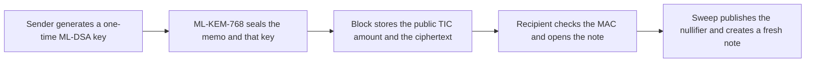

# Timecoin privacy

The token is Timecoin. The ticker is TIC. This repository states the privacy rules of the testnet at <https://github.com/Timechain-HQ/Timecoin>. It is not a mainnet, and it is not a claim of complete privacy.

The protocol hides the recipient's long-term identity and the memo. It publishes the amount. A node can reject inflation by arithmetic, so conservation does not depend on a proof the node cannot check.

## What stays off the block

- The long-term ML-KEM-768 view key is not a transaction field and not a block field.
- The memo is sealed to that view key.
- The one-time ML-DSA-44 spend key is sealed in the same payload.
- A sweep spends the received note into a new note addressed to the same wallet. The sender's view key does not open the swept note.

## What a node is supposed to see

| Data | On the block | Who can read the hidden part |
| --- | --- | --- |
| TIC amount | Yes | Everyone |
| Fee | Yes | Everyone |
| Note commitment and nullifier | Yes | Everyone |
| Long-term view key | No | The wallet that holds it |
| Memo | Ciphertext only | The recipient view key |
| One-time spend key | Ciphertext only | The recipient view key, until it is published by a spend |
| Proposer key | Yes | Everyone |
| Contract capability key | Yes, on the call that uses it | Everyone |

Amounts and the note graph are public on purpose. A chain that hid the amount without a proof could not show that outputs plus fees stay inside the inputs.

## How a payment moves

The sender can spend the original note if they keep the one-time key they generated. The sweep closes that window: the nullifier can be published once, and the new note is encrypted only to the recipient.

## Where the rest of the argument is

- [Visibility](docs/visibility.md) records each field a full node stores.
- [Note lifecycle](docs/note-lifecycle.md) follows one note from creation through sweep.
- [Limits](docs/limits.md) lists the attacks this testnet does not stop.

The day-one signature and encapsulation rules are in [post-quantum](https://github.com/Timechain-HQ/post-quantum). The wallet that opens notes is in [wallet](https://github.com/Timechain-HQ/wallet).
