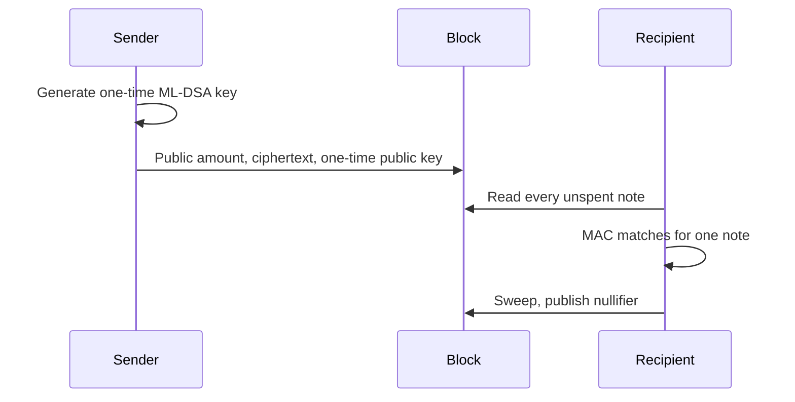

# Note lifecycle

One payment has five steps. Each step names the new public data and the data that stays sealed.

## 1. Keys

The recipient holds an ML-KEM-768 view key and an ML-DSA-44 capability key. The capability key authorizes contract calls. It is not required to receive TIC.

The sender generates a fresh ML-DSA-44 key for this note only. The sender also samples 32 bytes of rho.

## 2. Seal

The sender encapsulates to the recipient view public key and receives an ML-KEM ciphertext plus a shared secret. Encrypt-then-MAC under that secret seals the one-time private key and the memo. The block receives the ciphertext, the MAC, the one-time public key, rho, and the TIC amount.

## 3. Acceptance

The node checks the spend signatures, the nullifiers, and conservation:

```text
inputs = outputs + fee
```

For a contract call the same check includes call value and payout:

```text
inputs = outputs + fee + callvalue - payout
```

The node does not try to open the memo.

## 4. Scan

The wallet decapsulates every unspent note. If the MAC matches and the plaintext amount and rho match the public note, the wallet keeps the one-time spend key. Other view keys skip the note.

## 5. Sweep

The recipient spends the note to a new note sealed to their own view key. The block gains the nullifier. The sender, even with the old one-time key, cannot create a second spend. The sender's view key fails the MAC on the new note.



Until the sweep is in a block, a sender who stored the one-time key can spend the note first. The wallet treats sweep as the step that takes the note out of the sender's hands.
